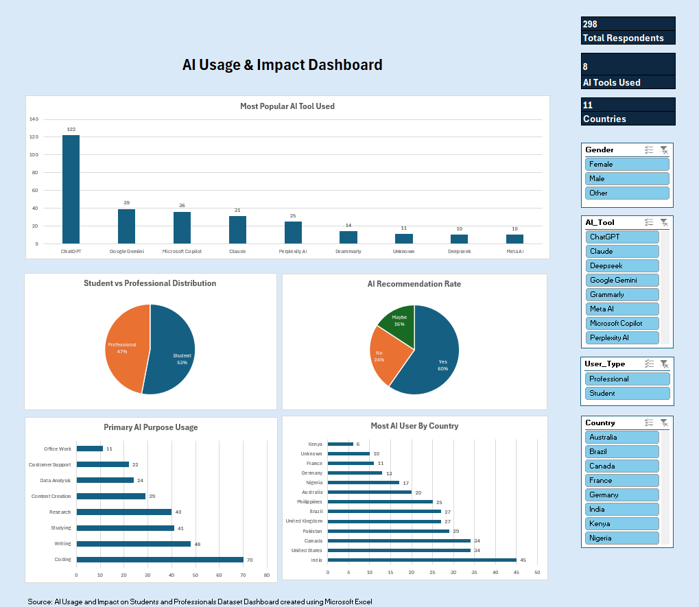
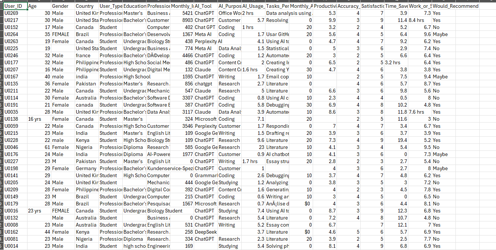
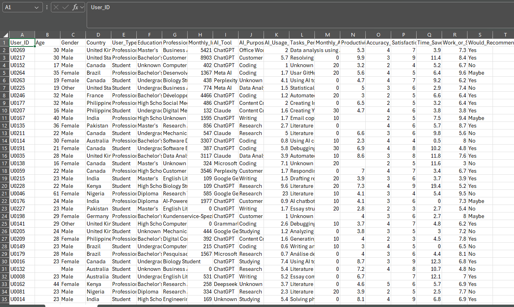
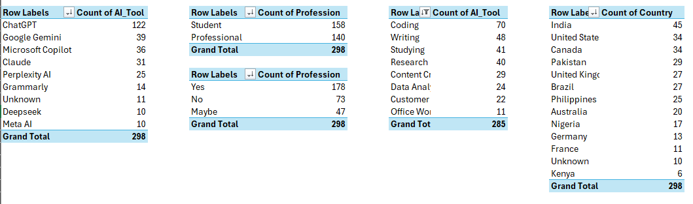

# AI Usage Analysis Dashboard

This project explores AI usage patterns using survey data collected from multiple respondents. The analysis was performed in Microsoft Excel, focusing on data cleaning, data visualization, and dashboard creation.

## Objectives
- Understand AI adoption patterns
- Analyze user recommendations toward AI tools
- Identify common AI usage purposes
- Visualize key findings through an interactive dashboard
  
## Tools Used
- Microsoft Excel
- Pivot Tables
- Pivot Charts
- Slicers
- GitHub

## Skills Demonstrated
- Data Cleaning
- Data Validation
- Data Analysis
- Dashboard Design
- Data Visualization
- Reporting and Documentation

## Dashboard Preview

## Project Workflow

### 1. Raw Dataset

### 2. Cleaned Dataset

### 3. Pivot Table Analysis

### 4. Final Dashboard

## Key Findings
- Most respondents indicated positive experiences with AI tools.
- A large proportion of users would recommend AI tools to others.
- Education and productivity were among the most common AI usage purposes.
- Usage patterns varied across countries and user groups.

## Repository Contents
- AI_Usage_Raw.csv
- AI_Usage_Cleaned.csv
- AI_Usage_Dashboard.xlsx
- AI_Usage_and_Impact_Report.docx
- AI_Usage_and_Impact_Report.pdf

## Author

**Nor Izzati Mohd Zahir**

Aspiring Data Analyst | Excel Dashboard Developer | Data Visualization Enthusiast
